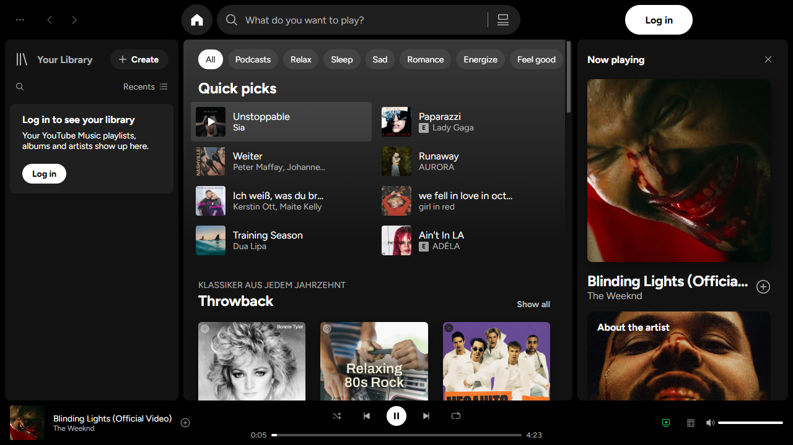
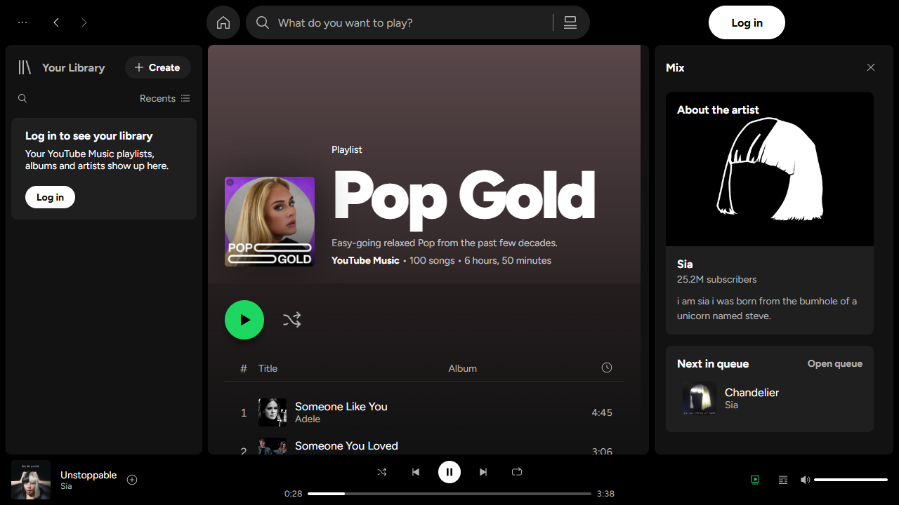
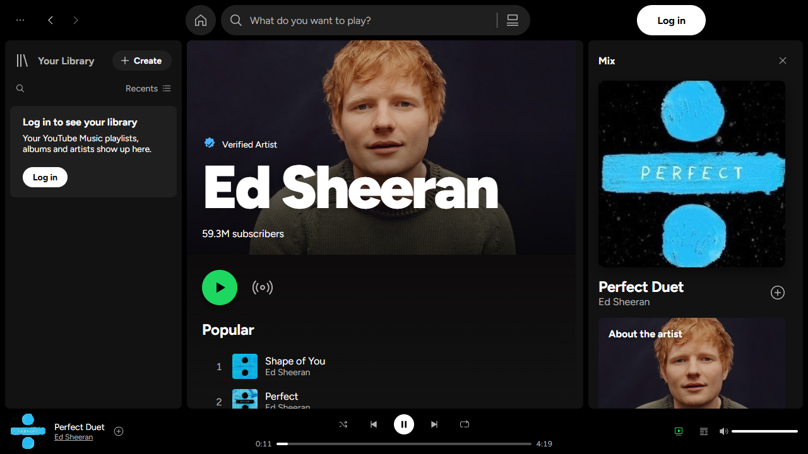
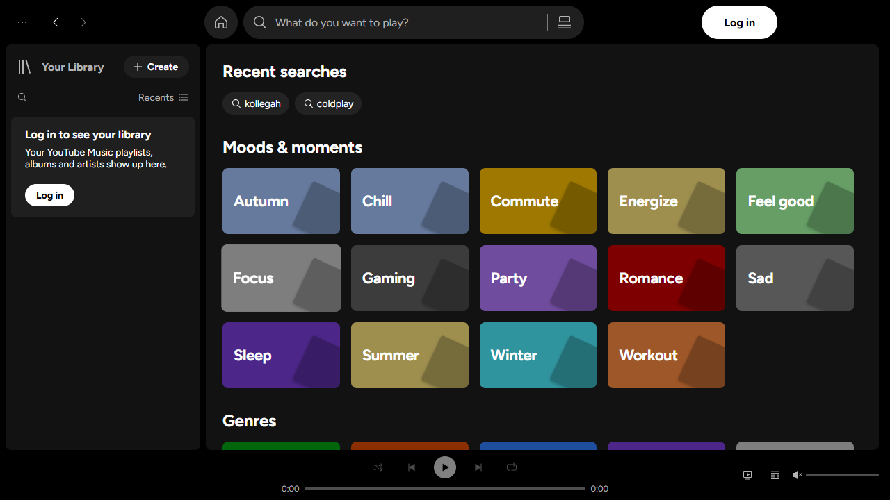

# Youtubify

**A Spotify-style desktop app for YouTube Music.**

Youtubify is a completely new interface, built from scratch on Spotify's desktop layout, that plays and browses
**your YouTube Music account**. Under the hood YouTube Music keeps running as the playback and data engine;
on screen you get the Spotify experience: Your Library on the left, the main view in the middle, the Now Playing
panel on the right and the player bar at the bottom.



| Playlist | Artist | Browse |
| --- | --- | --- |
|  |  |  |

## What you get

- **Your Library** – your YouTube Music playlists, albums and artists with their covers, Liked Songs pinned on top,
  Playlists / Albums / Artists filters, search and sorting, and a Create button for new playlists.
  Collapse it to covers only or drag its edge to resize, just like Spotify.
- **Home** – mood chips, a quick-access tile grid of what you listened to recently, and rows of mixes, playlists and
  albums that keep loading as you scroll.
- **Playlist and album pages** – a header tinted with the cover's colour, the big green play button, shuffle, and
  Spotify's track table that loads the rest of long playlists as you scroll.
- **Artist pages** – banner, "Popular" songs, albums, singles, videos and related artists, plus artist radio.
- **Search** – live suggestions while you type, a Top result next to Songs, and rows of artists, albums and playlists.
  With an empty search box you get recent searches and "Browse all" mood and genre tiles.
- **Now Playing panel and queue** – big artwork, "About the artist", what's next, and the full queue to jump around in.
- **Player bar** – play/pause, previous/next, seeking, volume, shuffle, repeat and saving the current song.
- **A loading screen** where the equalizer stripes form the logo before the app appears.

Everything comes from your own YouTube Music account, including your library, recommendations and likes.
Signing in and YouTube's cookie consent happen in a YouTube Music page shown right inside the app.

## How it works

Youtubify started as a fork of the [YouTube Music Desktop App (ytmdesktop)](https://github.com/ytmdesktop/ytmdesktop)
and keeps its Electron shell, integrations (tray, media keys, Discord presence, Last.fm, companion server) and settings.
On top of that it adds:

- **`src/renderer/youtubify/`** – the new Vue interface. Layout, sizes and colours follow the values Spotify's own web
  player uses (its Encore design tokens: `#121212` panels on black, 8px gaps, the `#1ed760` accent and so on).
- **`src/renderer/youtubify/ytm/`** – a client and parser for YouTube Music's internal API, turning its responses into
  simple playlists, albums, artists, tracks and shelves for the UI.
- **`src/main/ytm-bridge/`** – the link between the interface and a hidden YouTube Music view. The UI's requests run
  inside that view with your signed-in session; playback commands and live player state flow over IPC.
  The view only becomes visible when Google needs you to sign in or accept cookies.

The classic ytmdesktop view is still there: turn off **Settings → Appearance → Youtubify interface** and restart.
That classic view can also get a Spotify-inspired restyle (**Spotify layout** in the same section).

## Running and building

You need [Git](https://git-scm.com) and [Node.js](https://nodejs.org/) (v20 or newer). The project uses Yarn through
Corepack:

```sh
git clone https://github.com/mmaxx45/youtubify.git
cd youtubify
corepack enable   # or prefix the yarn commands below with "corepack"
yarn install
yarn start        # run in development
yarn package      # build the app into ./out
yarn make         # build installers
```

For installers on Windows you need Electron's build tools (`npm i -g @electron/build-tools`); on Linux, `fakeroot` and
`dpkg` (Debian-based) or `rpm`/`rpm-build` (Red Hat-based).

## Notes

- Youtubify is an unofficial personal project. It is not affiliated with, endorsed by or connected to Spotify or Google.
  "Spotify" and "YouTube Music" are trademarks of their owners; the Spotify-style look is used for personal use only.
- Spotify's own typeface is proprietary, so the interface uses [Figtree](https://github.com/erikdkennedy/figtree)
  (SIL Open Font License, see `src/assets/fonts/Figtree-OFL.txt`).
- Licensed under the GPL-3.0, like the ytmdesktop code it builds on (see [LICENSE](LICENSE)).

## Credits

Huge thanks to the [ytmdesktop](https://github.com/ytmdesktop/ytmdesktop) project and
[its contributors](https://github.com/ytmdesktop/ytmdesktop/graphs/contributors); the app shell, integrations and
settings all come from their work.
